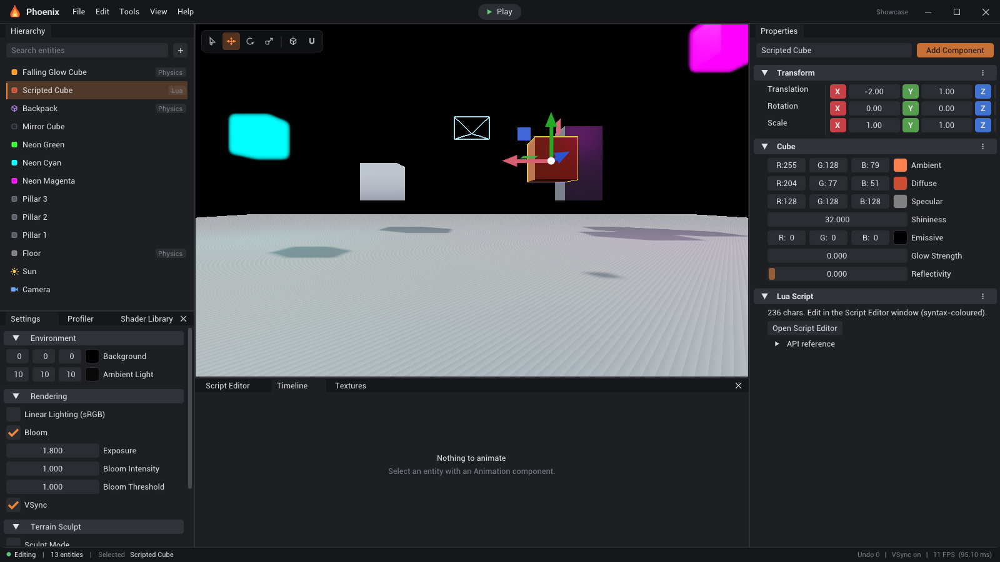
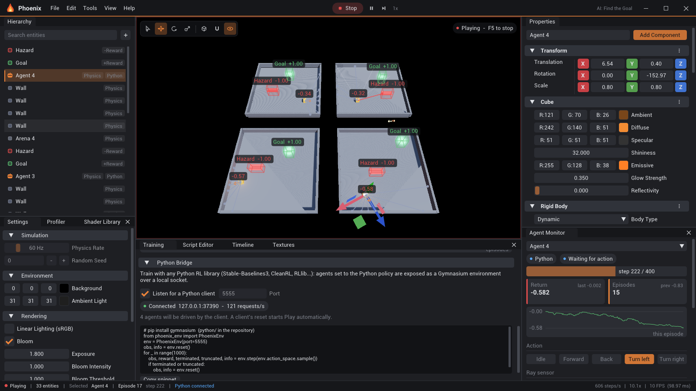
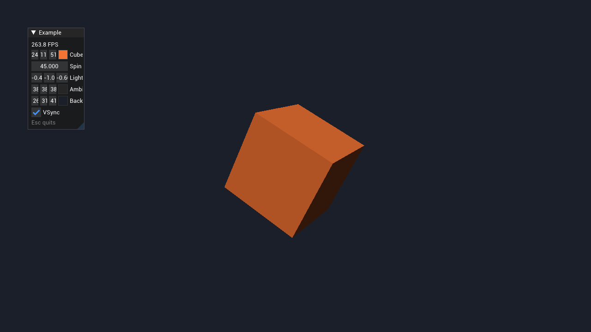
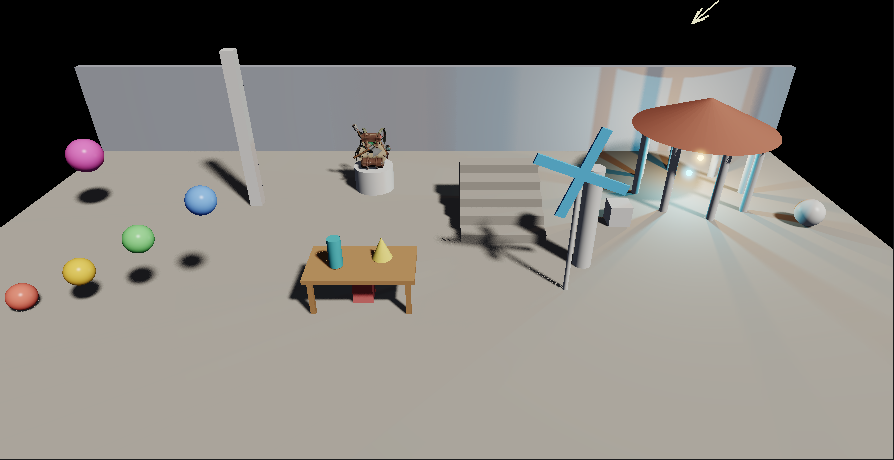
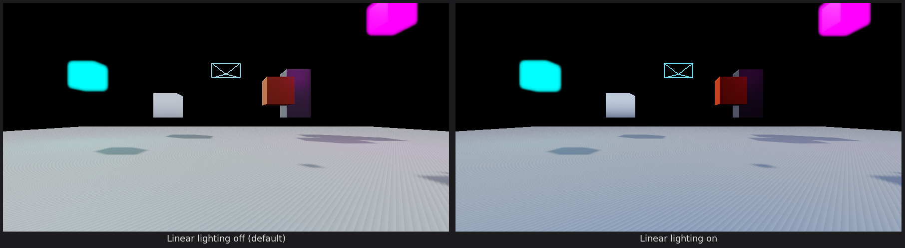
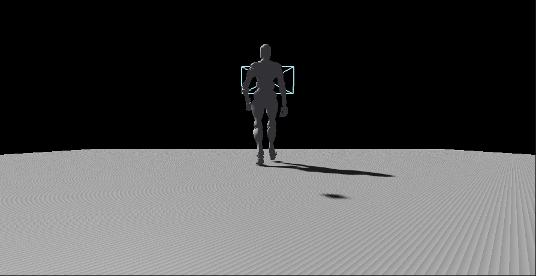
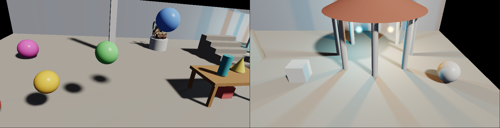

# Phoenix Engine

An **AI sandbox for designing reinforcement-learning environments**, built on a real-time
3D engine written in modern C++17 (inspired by [Hazel](https://github.com/TheCherno/Hazel)).
Its editor, **Sandbox**, lets you build physics worlds, add agents with sensors, rewards
and domain randomization, and expose them to your own RL code in Python through a
Gymnasium-compatible API. Phoenix provides the environment; the learning algorithm is yours.

> :warning: This project is under active development.



---

## Table of Contents

- [Highlights](#highlights)
- [AI Sandbox (Reinforcement Learning)](#ai-sandbox-reinforcement-learning)
- [Feature Reference](#feature-reference)
  - [Entity Component System](#entity-component-system)
  - [Rendering](#rendering)
  - [Lighting & Shadows](#lighting--shadows)
  - [Post-Processing (Bloom / Glow)](#post-processing-bloom--glow)
  - [Linear Lighting (sRGB)](#linear-lighting-srgb)
  - [Mesh Loading](#mesh-loading)
  - [Skeletal Animation](#skeletal-animation)
  - [Primitive Shapes](#primitive-shapes)
  - [Physics](#physics)
  - [Terrain](#terrain)
  - [Water](#water)
  - [Lua Scripting](#lua-scripting)
  - [Scene Serialization](#scene-serialization)
  - [The Editor](#the-editor)
- [Built-in Showcases](#built-in-showcases)
- [Components at a Glance](#components-at-a-glance)
- [Building](#building)
- [Project Structure](#project-structure)
- [Tech Stack](#tech-stack)
- [Resources](#resources)

---

## Highlights

- **RL environment design**: agents with discrete or continuous actions, ray sensors,
  reward zones, step/approach/fall rewards, episode limits and domain randomization.
- **Environment API for Python**: a lockstep Gymnasium bridge (single- and multi-agent)
  that any RL library can train against (Stable-Baselines3, CleanRL, RLlib, ...), plus a
  **physics API**: body state, forces / impulses / torques, teleports, materials, ray
  casts, contact events, gravity and direct stepping.
- **Fixed-timestep simulation** with time scaling, max-speed fast-forward, pause and
  single-step, reproducible seeds, and an Agent Monitor for live observations/actions.
- **Entity Component System** powered by [EnTT](https://github.com/skypjack/entt).
- **Forward renderer** (OpenGL 4.5 with GLSL ES 3.00 shaders) with a geometry-agnostic
  submission API.
- **Phong lighting**: global ambient, up to eight directional lights, up to four
  point lights, per-material emissive/reflectivity, diffuse + normal maps.
- **Soft shadows (PCSS)** from up to eight directional lights and four point lights (omnidirectional
  cube shadows): penumbrae widen with distance from the caster and harden at contact, with
  per-light softness/strength/bias, per-object cast/receive flags, and shadows on water.
- **HDR bloom / neon glow** pipeline with ACES tonemapping and exposure control.
- **Opt-in linear lighting**: sRGB-correct textures, colours and output.
- **Procedural environment reflections** (sky/ground) per material.
- **Skeletal animation** — GPU vertex skinning, loop modes, crossfades and events; loads
  rigged/animated models (FBX, glTF, Collada, …) via Assimp.
- **Rigid-body physics** via [Jolt](https://github.com/jrouwe/JoltPhysics): box, sphere,
  capsule, cylinder, convex-hull, triangle-mesh and heightfield colliders, plus joints.
- **Editable terrain** with a Blender-style sculpt brush (raise / lower / smooth).
- **Animated transparent water** surfaces for lakes/oceans.
- **Lua scripting** with an in-editor, syntax-highlighted code editor that runs while playing.
- **Scene serialization** (YAML) plus snapshot-based **undo/redo**.
- **Full editor**: hierarchy, properties inspector, gizmos, click-to-pick, play/pause/step,
  animation timeline, asset import.

---

## AI Sandbox (Reinforcement Learning)

Phoenix doubles as a sandbox for **designing environments for RL algorithms**: build a
world in the editor, drop in agents with sensors and rewards, and drive them from
**Python** with any Gymnasium-compatible library. The engine implements no learning
algorithm: it is the environment, your code is the agent.



### Building blocks

| Component | What it does |
| --- | --- |
| `AgentComponent` | Makes an entity a learning agent: **policy** (Keyboard / Random / Python), **control** scheme, **action space** (discrete or continuous), **observations**, **rewards** and episode limits. |
| `RaySensorComponent` | A fan of rays in the agent's plane. Each ray reports the free distance and a one-hot of the tag it hit (e.g. `Goal`, `Wall`, `Hazard`). Sees physics bodies and Reward Zones. |
| `RewardZoneComponent` | A box volume that rewards or penalises agents **on enter** or **per second inside**, and can end the episode (goals, hazards, checkpoints, areas). No collider needed. |
| `RandomizerComponent` | **Domain randomization**: every episode the entity respawns at its edit-time pose plus a random offset (and optional random heading). |
| `RigidBodyComponent` → *Upright* | Locks tilt so walking agents never fall over. |

**Control schemes** (`AgentComponent::Control`)

| Control | Discrete actions | Continuous actions (in [-1, 1]) |
| --- | --- | --- |
| **Move** — walk + turn (upright body or transform) | Idle, Forward, Back, Turn left, Turn right | Move, Turn |
| **Force** — push in world X/Z (rolling balls) | None, -Z, +Z, -X, +X | Force X, Force Z |
| **Custom** — your Lua `OnAction(actions)` | N choices | N values |

**Observations** (all roughly in [-1, 1]): velocity in the agent's frame, heading
(sin/cos), position, the offset and distance to the **nearest entity tagged as the
target** (so parallel arenas each track their own goal), every ray sensor value, and any
number of values the script adds in `CollectObservations()`. The inspector lists the
exact layout of the observation vector.

**Rewards**: a per-decision step reward, potential-based *approach* shaping toward the
target, Reward Zones, a fall-off height, and `AddReward(r)` / `EndEpisode()` from Lua.
Episodes also end at **Max Steps** (reported as *truncated*).

### Simulation & episodes

While playing, the scene runs as an environment:

- Physics steps at a **fixed rate** (Settings > Simulation, default 60 Hz); each agent
  decides every **Decision Period** steps and holds its action in between.
- **Time control**: 0.25x to 16x, or **Max** (as many steps as fit in each frame, with
  an option to stop drawing the viewport for even more speed), plus **Pause** (`F6`) and
  **Step one decision** (`F7`).
- When every agent is done, the scene **resets in place**: bodies teleport back to the
  edit-time layout plus randomization, scripts get `OnEpisodeBegin()`. A **seed** makes
  runs reproducible.

### Inspecting an environment

The **Training** panel shows run controls, the Python bridge, KPIs (episodes, mean and
best return, episode length) and return / length curves of whatever drives the agents,
exportable as CSV. The **Agent Monitor** shows one agent live: policy, episode progress, return trace,
the chosen action, a top-down **ray radar**, and every observation as a labelled bar.
The **viewport overlay** (eye button) draws ray hits coloured by tag, reward zones
(they light up when occupied), spawn ranges, headings, and each agent's running return.

### Training from Python

1. Set the agent's policy to **Python** and tick *Training > Python Bridge > Listen for
   a Python client* (port 5555, localhost only).
2. Run a client. A client's `reset()` starts Play automatically; the scene then advances
   **in lockstep** with `step()` calls, so the trainer sets the pace.

```python
import sys; sys.path.insert(0, "python")
from phoenix_env import PhoenixEnv          # Gymnasium Env (works without gymnasium too)

env = PhoenixEnv(port=5555)                 # first Python-policy agent
obs, info = env.reset(seed=0)
obs, reward, terminated, truncated, info = env.step(env.action_space.sample())
```

- `python/phoenix_env.py` — `PhoenixEnv` (single agent, passes Gymnasium's `check_env`)
  and `PhoenixMultiAgentEnv` (all Python agents, lists in/out).
- `python/examples/random_agent.py` — smoke test, needs only numpy.
- `python/examples/train_sb3.py` — Stable-Baselines3 PPO training + evaluation.
- `python/examples/physics_api.py` — tour of the physics API below.

The protocol is newline-delimited JSON over TCP (`hello`, `reset`, `step`, `close`, plus
the physics commands documented in [`BridgePhysics.cpp`](phoenix/src/AI/BridgePhysics.cpp)),
documented in [`Bridge.h`](phoenix/include/Phoenix/AI/Bridge.h), so clients in other
languages are easy to write.

### Physics API

Every env has a `physics` attribute, and `PhoenixSim` offers the physics API alone for
scenes **without** Python agents. While a client is connected the scene advances only
through `step()` / `physics.simulate(n)`, so your code owns the clock.

```python
from phoenix_env import PhoenixSim

sim = PhoenixSim(port=5555)
sim.reset(seed=0)                                  # edit-time layout + randomization
p = sim.physics
p.bodies()                                         # every rigid body: id, tag, type, pose, velocities, mass
p.apply_impulse("Ball", [0, 5, 0])                 # by tag (first match) or id
p.simulate(60)                                     # 60 fixed steps = 1 s at 60 Hz
hit = p.raycast([0, 5, 0], [0, -1, 0], max_distance=20, ignore="Ball")
events = p.contacts()                              # begun / ended since the last call
```

| Method | Purpose |
| --- | --- |
| `info()` | Gravity, fixed timestep, simulated time, body count |
| `bodies(tag=None, all=False)`, `body(entity)` | Body state: `id`, `tag`, `type` (static / dynamic / kinematic), `position`, `rotation` (XYZ Euler, radians), `scale`, `velocity`, `angular_velocity`, `mass`, `friction`, `restitution` |
| `set_body(entity, position=, rotation=, velocity=, angular_velocity=)` | Teleport and/or set velocities |
| `apply_force(entity, force, point=None)`, `apply_torque(entity, torque)` | Act during the next step (at a world point, a force also adds torque) |
| `apply_impulse(entity, impulse, point=None)`, `apply_angular_impulse(entity, impulse)` | Instant change of momentum |
| `set_material(entity, friction=, restitution=)` | Change surface properties live |
| `raycast(origin, direction, max_distance=100, ignore=None)` | First hit: `entity`, `tag`, `point`, `normal`, `distance` (or `None`) |
| `contacts()` | Contact begin/end events (`a`, `b`, `tag_a`, `tag_b`, `entered`, `time`), cleared on reset |
| `set_gravity(g)`, `simulate(steps=1)` | World gravity (also in Settings > Simulation); advance the simulation |

Forces need a dynamic body; errors come back as `PhoenixError` with the reason.

### Scripting agents in Lua

| Function | Purpose |
| --- | --- |
| `AddReward(r)`, `EndEpisode()` | Shape rewards and terminate from game logic |
| `GetEpisodeStep()`, `GetCumulativeReward()`, `GetEpisode()` | Episode state |
| `OnEpisodeBegin()` | Callback after each reset (re-initialise script state) |
| `CollectObservations()` + `AddObservation(v, ...)` | Extra observation values (set *Custom Values* on the agent) |
| `OnAction(actions)` | Custom control: a 1-based table (discrete `{index}` or continuous values) |
| `Heuristic()` → values | Keyboard policy for Custom agents |

### Building an environment

1. **Create > AI > Training Arena** for a walled floor; add walls, a **Goal Zone** and
   **Hazard Zones**.
2. **Create > AI > Agent**; configure control, observations and rewards in Properties.
3. Add **Spawn Randomizers** to the agent and goal so the policy has to generalise.
4. Test with the **Keyboard** policy (WASD) or **Random**, then connect your RL code
   with the **Python** policy.

**Help > AI Sandbox Guide** walks through the same steps inside the editor.

---

## Feature Reference

### Entity Component System

Scenes are EnTT registries; an `Entity` is a lightweight handle wrapping an
`entt::entity` plus a `Scene*`. Components are plain structs in
[`Component.h`](phoenix/include/Phoenix/Scene/Component.h). System logic runs inline in
`Scene::OnUpdate`. Create entities from code (`Scene::CreateEntity`) or from the editor
hierarchy panel.

### Rendering

The renderer ([`renderer.cpp`](phoenix/src/renderer/renderer.cpp)) exposes a
geometry-agnostic path:

```cpp
Renderer::BeginScene(projection, view, cameraPos);
Renderer::SetLights(ambient, dirLights, dirLightDirs, numDirLights,
                    pointLights, pointLightPositions, numPointLights);
Renderer::Submit(vertexArray, material, transform, diffuseMap);   // any indexed mesh
Renderer::SubmitAnimated(vertexArray, material, transform, boneMatrices, diffuseMap);
Renderer::EndScene();
```

Vertices are interleaved `position / normal / texcoord / boneIDs / weights`. The
renderer also draws editor aids: selection **outlines** (stencil-based), **camera frustum
gizmos**, and **directional-light arrows**. A global **wireframe** toggle is available
per entity via the `WireframeComponent`. [`Example/`](Example/ExampleLayer.cpp) is a
one-file program that uses exactly this API to draw a lit, spinning cube.



Textures loaded from disk get a full mip chain with trilinear + anisotropic filtering, and
are cached by path so a model whose sub-meshes share a material uploads it once.

### Lighting & Shadows

- **Ambient**: a single global ambient colour (editable in Settings, serialized).
- **Directional lights** (`DirLightComponent`): up to 8; each aims along its entity's
  local −Z, visualized with an arrow gizmo, and can cast its own shadow.
- **Point lights** (`PointLightComponent`): up to 4, with constant/linear/quadratic
  attenuation.
- **Emissive objects also emit light**: any material with `emissiveStrength > 0` is added
  as a gentle coloured point light onto its surroundings (until the 4-light cap).
- **Shadows** — see below.

#### Shadows



- **Multiple shadowed lights**: every directional light (up to 8) and every point light
  (up to 4) can cast its own shadow (*Casts Shadow* on the light). Directional lights
  render into tiles of one depth atlas (2048² each when one or two cast, 1024² for up to
  eight); point lights render six cube faces each into a second atlas, so they throw
  shadows in every direction. Overlapping coloured lights give coloured shadows.
- **Soft shadows with contact hardening** (percentage-closer soft shadows): a blocker
  search finds how far the receiver is behind its occluders, and the filter widens with
  that distance and with the light's size. Shadows stay crisp where an object touches the
  ground and blur further away. Filtering uses hardware PCF taps on a per-pixel-rotated
  Vogel disk. **Softness** is the light's size: the sun's angular radius in degrees (the
  real sun is ~0.27°), or a point light's bulb radius in world units; 0 gives hard
  shadows.
- **Shadows on other objects**: everything that draws (cubes, shapes, meshes, terrain) can
  cast onto everything else, including itself; the sun's shadow also falls on **water**.
  Per object, the material's **Cast Shadows** / **Receive Shadows** switch it off.
  Geometry on a light entity (its marker cube or bulb) never casts.
- **Stable, scene-fitted sun shadows**: a directional light's shadow box covers the view
  out to its **Distance** (or the whole scene when that is smaller), reaches back to every
  caster, and moves in whole texels so edges don't crawl as the camera moves. Casters
  outside a light's frustum (or a point light's range) are culled.
- **No acne**: receivers are offset along their normal and the depth bias grows with the
  surface slope and filter size. **Bias** / **Normal Bias** (in shadow texels) and
  **Strength** are per light.
- Animated meshes are skinned in the shadow passes too, so a walking character casts a
  correctly posed shadow.
- **Settings → Shadows** turns all shadows off; **Shadow Samples** trades smoothness of
  wide penumbrae for speed (default 16).

`Scene::OnUpdate` drives this; outside a scene the renderer API is (all before `BeginScene`,
light indices as passed to `SetLights`):

```cpp
Renderer::BeginShadows(numDirShadows, numPointShadows);        // once per frame
Renderer::BeginShadowPass(i, lightSpaceMatrix, light.shadow);   // directional light i
Renderer::SubmitShadow(vertexArray, transform);                // ...each caster
Renderer::EndShadowPass();
for (int face = 0; face < 6; face++){                          // point light j
    Renderer::BeginPointShadowPass(j, face, position, range, light.shadow);
    Renderer::SubmitShadow(vertexArray, transform);            // ...each caster
    Renderer::EndShadowPass();
}
```

### Post-Processing (Bloom / Glow)

An HDR pipeline ([`Bloom.cpp`](phoenix/src/renderer/Bloom.cpp)) renders the scene to an
`RGBA16F` target, extracts bright pixels (threshold) while downsampling to half
resolution, blurs them with a separable Gaussian (bilinear-tap, ping-pong), then
composites with **ACES** tonemapping and an **exposure** control. Push a material's
`emissive * emissiveStrength` above 1.0 to make it bloom — the basis of the neon-glow look.
All knobs (intensity, threshold, exposure) live in the editor Settings panel.

### Linear Lighting (sRGB)

Off by default, so existing scenes keep their look. Turn on **Linear Lighting (sRGB)** in
Settings (or `Renderer::SetLinearLighting(true)`) to light in linear space:

- diffuse maps are sampled through an sRGB texture view (hardware-decoded to linear);
  normal maps stay linear;
- colours picked in the editor — materials, emissive, lights, ambient, water, background —
  are treated as sRGB and converted to linear before shading;
- the composite pass encodes the tonemapped result back to sRGB. The HDR path is used
  whenever linear lighting is on, even with bloom off.

Light falloff, blending and bloom are then physically correct. Scenes tuned without it
usually need their lights and materials re-balanced.



### Mesh Loading

Models are loaded with **Assimp** ([`Mesh.cpp`](phoenix/src/renderer/Mesh.cpp)) and support
**diffuse textures**; any material can also take a diffuse and normal map from the
editor's **Textures** panel. Loading is **asynchronous**: the file is parsed on a worker thread and
the GPU buffers/textures are uploaded on the main thread in `Model::Update()`, so the editor
never blocks on a slow import. Add via the editor (Mesh component) or `CreateRef<Model>(path)`.

### Skeletal Animation

Full GPU vertex skinning ([`Animation.h`](phoenix/include/Phoenix/renderer/Animation.h) /
[`Animation.cpp`](phoenix/src/renderer/Animation.cpp)):

- The model loader extracts the **bone hierarchy**, per-vertex **bone weights** (up to 4),
  and all **embedded animation clips**.
- Each clip's node hierarchy is flattened once at load time (parent before child, with
  its channel and bone slot resolved), so posing a skeleton does no string lookups.
- `Bone` samples keyframes with a binary search (lerp position/scale, slerp rotation);
  `Animator` walks the flattened skeleton each frame and produces up to `MAX_BONES` (100)
  final matrices.
- **Crossfades** blend each joint's translation / rotation / scale (not the final
  matrices, which would shrink and shear limbs mid-blend). Joints are matched by name, so
  clips merged from other files blend too. Interrupting a fade continues from the pose on
  screen instead of popping.
- **Loop modes** (Loop / Once / PingPong), speed, pause/seek, and named **events** at clip
  times that call the entity's Lua `OnAnimationEvent(name)`.
- The vertex shader blends the bone matrices by weight (`u_BoneMatrices[]`, gated by
  `u_Animated`), in both the lit pass and the shadow pass.
- Drive it with an `AnimationComponent` (`clip`, `playing`, `speed`, `loopMode`,
  `crossfade`, `extraClips`, `events`), from Lua, or by scrubbing in the **Timeline** panel.
  `extraClips` merges animation-only files (e.g. Mixamo "without skin" exports) onto the rig.



Works with any rigged + animated file Assimp can read (FBX, glTF/GLB, Collada/DAE, …).
See [Built-in Showcases](#built-in-showcases) for the walking-robot demo and how to download
a free rigged character + walk cycle from Mixamo.

### Primitive Shapes

Built-in procedural meshes ([`Primitives.cpp`](phoenix/src/renderer/Primitives.cpp)) —
**Cube, Sphere, Cylinder (pillar), Cone, Plane** — exposed through a `PrimitiveComponent`
(type + material). Meshes are unit-sized and cached/shared across entities. They render with
the full material pipeline (emissive, reflectivity, wireframe), cast shadows, show selection
outlines, and (with a Rigid Body + Mesh Collider) collide as convex hulls or triangle meshes.
Create from the hierarchy panel's **Create Shape** menu or **Add Component → Shape**.

### Physics

Rigid-body simulation via **Jolt Physics** (pimpl wrapper in
[`Physics`](phoenix/src/Physics)):

- `RigidBodyComponent` — Static / Dynamic / Kinematic.
- Colliders: **Box**, **Sphere**, **Capsule**, **Cylinder**, **Convex hull** & **triangle
  mesh** (`MeshColliderComponent`, from the entity's mesh/primitive geometry), and a
  **heightfield** collider auto-generated for terrain.
- **Joints** (`JointComponent`): point, distance (rope/tether) and hinge (with optional
  angle limits), to another body or to the world.
- Press **Play** to start the simulation; transforms are written back to entities every
  frame. Press **Stop** to restore the edit-time state.

### Terrain

`TerrainComponent` is an editable heightmap (resolution × resolution grid) rendered as a mesh
with analytic normals and an optional static triangle-mesh collider. A Blender-style
**sculpt tool** (raise / lower / smooth brush, configurable radius & strength) lets you carve
hills, valleys, and riverbeds directly in the viewport.

### Water

`WaterComponent` is an animated, transparent surface (a flat grid displaced by a sum-of-sines
wave in the shader) with Fresnel environment reflection, sun specular, and configurable
colour/alpha/amplitude/wave-scale/speed. Place one over a sculpted terrain basin to make a
lake.

### Lua Scripting

`LuaScriptComponent` holds a Lua source string that runs while the scene is **playing**
(per-entity, sandboxed `lua_State`: only the base, table, string, math and utf8 libraries
are loaded — no `io`/`os`). The API covers:

- **Transform**: `GetTranslation`, `SetTranslation`, `GetRotation`, `SetRotation`,
  `SetScale`, `Translate`, `Rotate`, `MoveForward`
- **Look**: `SetColor`, `SetEmissive`
- **Animation**: `PlayAnimation`, `CrossFade`, `Pause/Resume/StopAnimation`,
  `Get/SetAnimationTime`, `GetAnimationDuration`, `SetAnimationSpeed`, `SetAnimationLoop`,
  `IsAnimationPlaying`, `IsAnimationFinished`, `GetAnimationName`, `HasAnimation`
- **Physics**: `ApplyImpulse`, `ApplyForce`, `Get/SetVelocity`, `SetAngularVelocity`, `RayCast`
- **Input**: `IsKeyDown`, `IsKeyPressed`

The editor
includes a **dedicated, syntax-highlighted code editor** window (Lua keyword/API colouring,
Tab autocompletion for built-in functions, manual caret rendering) so you can edit scripts
without leaving the engine.

### Scene Serialization

Scenes serialize to **YAML** (`.phx`) via `SceneSerializer` — every component, including
materials, terrain heightfields, water, primitives, lights, physics, animation config and
Lua source. The same machinery powers **snapshot-based undo/redo**, which reconciles the
live scene in place (so undoing an unrelated edit never reloads your meshes).

### The Editor

The Sandbox app provides:

- **Custom title bar** — the editor runs in an undecorated window and draws its own bar:
  logo, **File / Edit / Tools / View / Help** menus, a centred **Play / Stop** button, the
  current scene name and minimize / maximize / close controls. Drag the bar to move the
  window, double-click it to maximize, and drag any window edge to resize.
- **Hierarchy** panel — searchable entity list with type icons and policy / reward /
  Lua / Physics badges; create entities from the **+** button or the right-click menu
  (AI building blocks, lights, terrain, water, shapes).
- **Properties** inspector — collapsible per-component sections with live editing and a
  grouped **Add Component** menu (components the entity already has are greyed out).
- **Viewport** — ImGuizmo transform gizmos with an on-image tool strip (select / move /
  rotate / scale, local / world space, snapping), click-to-pick selection, terrain
  sculpting, and a red frame + badge while the simulation is playing.
- **Timeline** — pick a clip, play/pause/stop, loop mode, speed, and scrub the selected
  entity's animation, with its event markers on the ruler (events are added in the
  Animation component's properties).
- **Training** and **Agent Monitor** panels — see [AI Sandbox](#ai-sandbox-reinforcement-learning).
- **Script Editor**, **Textures**, **Shader Library**, **Profiler** panels.
- **Settings** — simulation (physics rate, gravity, seed), environment (background, ambient), rendering (linear lighting,
  bloom/exposure, shadows/shadow samples, vsync) and the terrain sculpt brush.
- **Status bar** — edit/play state, entity count, selection, episode / generation, Python
  connection, simulation speed and FPS.

Every panel can be toggled from **View**, and **View → Reset Layout** restores the default
docking layout. **Help → Keyboard Shortcuts** (`F1`) lists the bindings below.

**Controls**

| Action | Binding |
| --- | --- |
| Translate / Rotate / Scale gizmo | `W` / `E` / `R` (or the viewport tool strip) |
| No gizmo | `Q` |
| Snap while dragging a gizmo | hold `Ctrl` (or toggle snapping in the tool strip) |
| Orbit camera | Right-mouse drag |
| Pan camera | Middle-mouse drag |
| Zoom | Mouse wheel |
| Select entity | Left-click in viewport |
| Deselect | `Esc` |
| Delete entity | `Del` |
| Undo / Redo | `Ctrl+Z` / `Ctrl+Shift+Z` |
| New / Import / Export scene | `Ctrl+N` / `Ctrl+O` / `Ctrl+S` |
| Play / Stop | `F5` or the title-bar button |
| Pause / Step one decision | `F6` / `F7` |
| Frame selection | `F` |
| Drive a Keyboard-policy agent | `WASD` / arrow keys |

---

## Built-in Showcases

Open via **File → Showcases**:

- **AI: Find the Goal** (loaded at startup) — four parallel arenas; walker agents with
  7-ray sensors must reach a randomized goal while avoiding a randomized hazard
  (discrete actions; four agents for the multi-agent API).
- **AI: Roller Ball** — balls must use continuous force control to reach a target on a
  platform without rolling off.
- **Bloom & Shadows** — bloom, neon glow, emissive lighting, environment reflection,
  shadows, a textured backpack dropping with a convex collider, and a Lua-scripted cube.
- **Water** — a sculpted terrain lake basin filled with animated water and
  glowing buoys.
- **Robot** — skeletal animation: a rigged character on a shadow-receiving
  floor with a follow camera. Press **Play**, click the viewport, then drive it with the
  arrow keys (Shift runs, Space jumps); a Lua state machine crossfades idle / walk / run /
  jump.
- **Multi-Shadow** — three coloured directional lights, each casting its own
  shadow.
- **Shadows** — soft sun shadows (a row of spheres at rising heights, a tall
  obelisk) whose penumbrae widen away from the contact point; shadows on other objects (a
  table shading the box beneath it and catching the shadows of what stands on it, a
  pillar and a spinning fan shading a staircase, the backpack on a pedestal); and a lantern
  where two coloured point lights cast radial cube-map shadows onto the floor and back
  wall. Press **Run** to spin the fan, bounce a sphere and orbit the lantern lights.


- **Physics** — restitution and friction tests, a jointed wrecking ball, a
  hinged seesaw, a Lua-driven kinematic spinner, a tethered balloon and a CCD cannon.

### Getting a walking character for the Robot Showcase

The robot showcase loads `assets/models/robot.fbx`. To get a free rigged model + walk cycle:

1. Sign in at **[mixamo.com](https://www.mixamo.com)** (free Adobe account).
2. Pick a rigged character (e.g. *X Bot*) or upload your own (it auto-rigs).
3. **Animations** tab → search **"Walking"** → choose a walk cycle.
4. **Download** as **FBX Binary**, **Skin = With Skin** (bundles mesh + skeleton + animation),
   30 FPS. Keep *In Place* on so it walks without drifting.
5. Rename to `robot.fbx`, drop it in `Sandbox/assets/models/`, rebuild (or copy into
   `build/Sandbox/assets/models/`), then **File → Showcases → Robot**.

glTF (`.glb`), Collada (`.dae`) and Sketchfab "with animation" exports also work. Full notes
in [`Sandbox/assets/models/README.txt`](Sandbox/assets/models/README.txt).

---

## Components at a Glance

| Component | Purpose |
| --- | --- |
| `TagComponent` | Entity name |
| `TransformComponent` | Translation / rotation / scale |
| `CameraComponent` | Scene camera (perspective/ortho), primary flag |
| `MeshComponent` | Assimp-loaded model + material |
| `AnimationComponent` | Skeletal animation playback, loop mode, crossfade, extra clips, events |
| `PrimitiveComponent` | Built-in shape (cube/sphere/cylinder/cone/plane) + material |
| `CameraFollowComponent` | Third-person camera that trails a tagged entity |
| `CubeComponent` | Built-in unit cube + material |
| `Material` | Ambient/diffuse/specular/shininess + emissive + reflectivity + cast/receive shadows |
| `DirLightComponent` | Directional light (sun), with soft shadow settings |
| `PointLightComponent` | Point light with attenuation and an omnidirectional shadow |
| `RigidBodyComponent` | Static / Dynamic / Kinematic body |
| `Box/Sphere/Capsule/CylinderColliderComponent` | Primitive colliders |
| `MeshColliderComponent` | Convex-hull / triangle-mesh collider |
| `JointComponent` | Point / distance / hinge constraint |
| `TerrainComponent` | Editable heightmap terrain |
| `WaterComponent` | Animated transparent water surface |
| `WireframeComponent` | Draw the entity as wireframe |
| `LuaScriptComponent` | Lua script run while playing |
| `AgentComponent` | RL agent: policy, control, action space, observations, rewards |
| `RaySensorComponent` | Ray fan observation (distance + tag one-hot per ray) |
| `RewardZoneComponent` | Reward / penalty volume, optionally ending the episode |
| `RandomizerComponent` | Per-episode spawn randomization |
| `NativeScriptComponent` | C++ scriptable entity |

---

## Building

Phoenix targets **Linux** and needs **OpenGL 4.5** and **CMake 3.16+**.

### Dependencies

Install via your system package manager (apt names shown):

```bash
sudo apt install build-essential cmake \
    libglfw3-dev libglew-dev libglm-dev libopengl-dev \
    libfmt-dev libspdlog-dev libassimp-dev libyaml-cpp-dev liblua5.3-dev
```

- **Jolt Physics** is fetched and built from source automatically by CMake (FetchContent).
- **EnTT** is vendored as a single header in `third_party/`.
- **ImGui / ImGuizmo** are vendored in the engine sources.

### Compile & Run

```bash
cmake -S . -B build              # defaults to RelWithDebInfo
cmake --build build -j$(nproc)

./build/Sandbox/Sandbox          # the editor
./build/Example/Example          # the minimal example
```

Pass `-DCMAKE_BUILD_TYPE=Debug` to enable engine asserts and the OpenGL debug-message
callback.

Assets are copied next to each executable on every build, so shader edits are picked up on
the next launch. The engine's own runtime assets (its shaders and the UI fonts) live in
`phoenix/assets/`; an app gets them with `phoenix_copy_assets(<target>)` in its
`CMakeLists.txt`, then copies its own assets on top. Apps load assets by relative path, so
`main()` changes to the executable's directory first (see `Example/main.cpp`).

---

## Project Structure

```
Phoenix/
├── phoenix/                  # the engine (static library)
│   ├── include/Phoenix/      # public headers
│   │   ├── core/  event/  renderer/  Scene/  Physics/  AI/  imGui/  Math/  opengl/
│   ├── src/                  # implementation (renderer, Scene, Physics, AI, ...)
│   │   └── AI/               # Environment (episodes, rewards, resets), Bridge + physics API
│   └── assets/               # engine shaders + UI fonts (copied next to every app)
├── Sandbox/                  # the editor application
│   ├── MainLayer.cpp         # title bar, menus, viewport, showcases, gizmos, undo/redo
│   ├── Panels/SceneEditor.*  # hierarchy, properties, timeline, Lua editor panels
│   ├── Panels/AIPanels.*     # Training dashboard, Agent Monitor, viewport AI overlays
│   ├── Panels/EditorUI.h     # vector icons, charts and widgets shared by the editor UI
│   ├── AIPrefabs.*           # agent / goal / hazard / wall / arena building blocks
│   ├── assets/               # showcase models, textures, extra shaders
│   └── backpack/             # textured backpack model for the main showcase
├── Example/                  # minimal app: a lit cube through the Renderer API
├── python/                   # Gymnasium client for the bridge + examples
├── third_party/entt/         # vendored EnTT single header
├── images/                   # screenshots
└── CMakeLists.txt
```

---

## Tech Stack

| Area | Library |
| --- | --- |
| Windowing / input | GLFW |
| GL loading | GLEW |
| Math | GLM |
| ECS | EnTT (vendored) |
| Physics | Jolt Physics (fetched) |
| Model import | Assimp |
| Scripting | Lua 5.3 |
| Serialization | yaml-cpp |
| UI | Dear ImGui + ImGuizmo (vendored) |
| Logging | spdlog / fmt |
| RL bridge | POSIX TCP sockets, newline-delimited JSON (Python: `phoenix_env.py`) |

---

## Resources

- [The Book of Shaders](https://thebookofshaders.com/)
- [Learn OpenGL](https://learnopengl.com/Getting-started)
- [Hazel Engine](https://github.com/TheCherno/Hazel) (inspiration)
